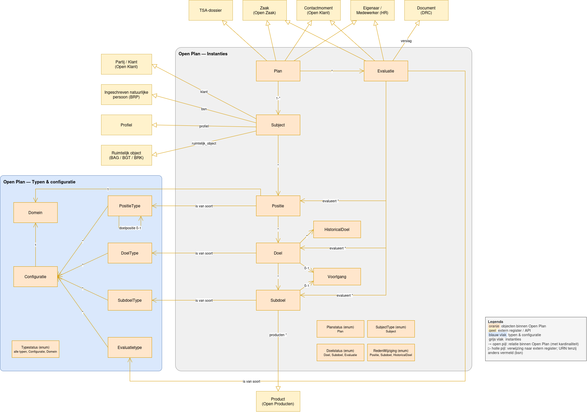

=========
Open Plan
=========

:Version: 0.1.0
:Source: https://github.com/maykinmedia/open-plan
:Keywords: ``Plannen``

|docs| |docker|

Een plek voor gemeenten om plannen te beheren. 
(`English version`_)

Ontwikkeld door `Maykin B.V.`_.

Introductie
===========

Open Plan is een applicatie waarin plannen centraal staan en gekoppeld zijn aan personen.
Binnen een plan kunnen doelen worden vastgelegd, inclusief producten of zaken die moeten
worden afgerond om deze doelen te behalen.
Andere systemen kunnen via een REST API communiceren met Open Plan om bijvoorbeeld
plangegevens op te halen of doelen te beheren.

Informatiemodel
===============

API specificatie
================

|oas|

==============  ==============  =============================
Versie          Release datum   API specificatie
==============  ==============  =============================
latest          n/a             `ReDoc <https://redocly.github.io/redoc/?url=https://raw.githubusercontent.com/maykinmedia/open-plan/main/src/plan-openapi.yaml>`_,
                                `Swagger <https://petstore.swagger.io/?url=https://raw.githubusercontent.com/maykinmedia/open-plan/main/src/plan-openapi.yaml>`_,
                                (`verschillen <https://github.com/maykinmedia/open-plan/compare/0.1.0..main#diff-b9c28fec6c3f3fa5cff870d24601d6ab7027520f3b084cc767aefd258cb8c40a>`_)
0.1.0           YYYY-MM-DD      `ReDoc <https://redocly.github.io/redoc/?url=https://raw.githubusercontent.com/maykinmedia/open-plan/0.1.0/src/plan-openapi.yaml>`_,
                                `Swagger <https://petstore.swagger.io/?url=https://raw.githubusercontent.com/maykinmedia/open-plan/0.1.0/src/plan-openapi.yaml>`_
==============  ==============  =============================

Vorige versies worden nog 6 maanden ondersteund nadat de volgende versie is 
uitgebracht.

Er is één manier om te authenticeren met de API:

* Een API-token kan worden aangemaakt in Open Organisatie admin -> Tokens.

Zie: `Alle versies en wijzigingen <https://github.com/maykinmedia/open-plan/blob/main/CHANGELOG.rst>`_

Ontwikkelaars
=============

|build-status| |coverage| |ruff| |docker| |python-versions|

Deze repository bevat de broncode voor Open Plan. Om snel aan de slag
te gaan, raden we aan om de Docker image te gebruiken. Uiteraard kan je ook
het project zelf bouwen van de broncode. Zie hiervoor
`INSTALL.rst <INSTALL.rst>`_.

Quickstart
----------

1. Download en start Open Plan:

   .. code:: bash

      wget https://raw.githubusercontent.com/maykinmedia/open-plan/main/docker-compose.yml
      docker-compose up -d --no-build
      docker-compose exec web src/manage.py loaddata demodata
      docker-compose exec web src/manage.py createsuperuser

2. In de browser, navigeer naar ``http://localhost:8000/`` om de beheerinterface
   en de API te benaderen.

Links
=====

* `Documentatie <https://open-plan.readthedocs.io/>`_
* `Docker image <https://hub.docker.com/r/maykinmedia/open-plan>`_
* `Issues <https://github.com/maykinmedia/open-plan/issues>`_
* `Code <https://github.com/maykinmedia/open-plan>`_

Licentie
========

Copyright © Maykin 2025

Licensed under the EUPL_

.. _`English version`: README.EN.rst

.. _`Maykin B.V.`: https://www.maykinmedia.nl

.. _`EUPL`: LICENSE.md

.. |build-status| image:: https://github.com/maykinmedia/open-plan/actions/workflows/ci.yml/badge.svg?branch=main
    :alt: Build status
    :target: https://github.com/maykinmedia/open-plan/actions/workflows/ci.yml

.. |docs| image:: https://readthedocs.org/projects/open-plan/badge/?version=latest
    :target: https://open-plan.readthedocs.io/
    :alt: Documentation Status

.. |coverage| image:: https://codecov.io/github/maykinmedia/open-plan/branch/main/graphs/badge.svg?branch=main
    :alt: Coverage
    :target: https://codecov.io/gh/maykinmedia/open-plan

.. |ruff| image:: https://img.shields.io/endpoint?url=https://raw.githubusercontent.com/astral-sh/ruff/main/assets/badge/v2.json
    :target: https://github.com/astral-sh/ruff
    :alt: Ruff

.. |docker| image:: https://img.shields.io/docker/v/maykinmedia/open-plan?sort=semver
    :alt: Docker image
    :target: https://hub.docker.com/r/maykinmedia/open-plan

.. |python-versions| image:: https://img.shields.io/badge/python-3.12%2B-blue.svg
    :alt: Supported Python version

.. |oas| image:: https://github.com/maykinmedia/open-plan/actions/workflows/oas.yml/badge.svg
    :alt: OpenAPI specification checks
    :target: https://github.com/maykinmedia/open-plan/actions/workflows/oas.yml
